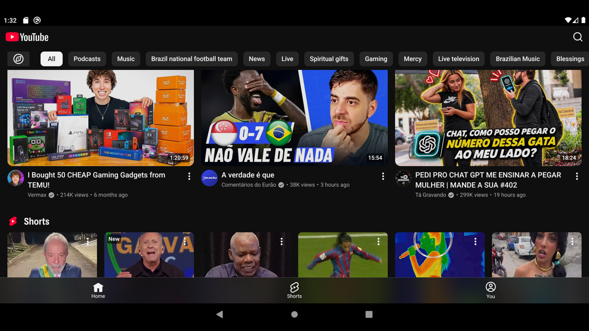
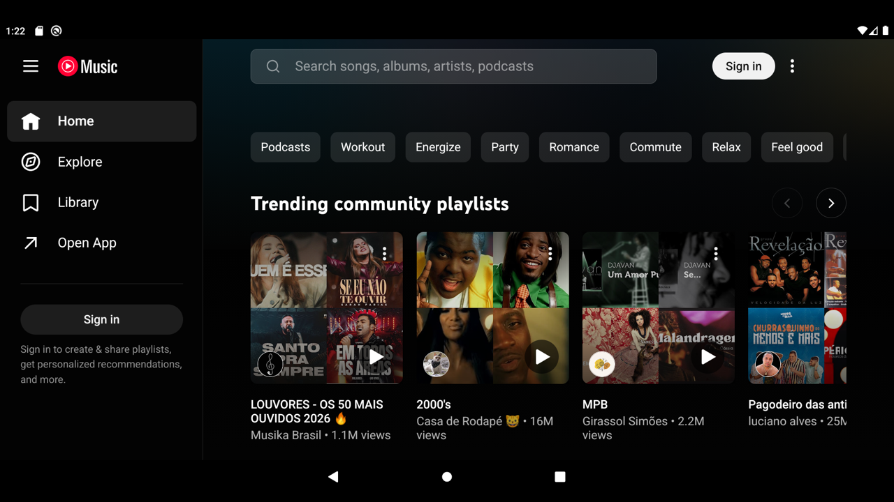

# BYD Apps for YouTube and YT Music

> **Unofficial project.** Not affiliated with, endorsed by, or sponsored by
> Google LLC, YouTube, or BYD Company Limited. YouTube and YT Music are
> trademarks of Google LLC; BYD is a trademark of BYD Company Limited.

Two standalone Android apps for BYD DiLink 3 head units. Each app embeds
Mozilla's **GeckoView** engine and loads the official YouTube or YT Music web
app, so the current sites render correctly without depending on the car's
system WebView.

| App | Package | Release asset |
| --- | --- | --- |
| **YouTube BYD** | `dev.theolm.bydapps.youtube` | `YouTubeBYD-<version>-android-arm64-v8a.apk` |
| **YT Music BYD** | `dev.theolm.bydapps.ytmusic` | `YTMusicBYD-<version>-android-arm64-v8a.apk` |

## Why these apps exist

DiLink 3 runs Android 10 without Google Play Services. Native YouTube and
YT Music builds expect Google services for sign-in and other Google features,
and sideloading repackaged or patched APKs from third parties is risky: those
builds are unaudited and may violate the services' terms.

These apps take a different route:

- a standard embedded browser engine (**GeckoView**) loads the official web
  apps, so no Google Play Services are required;
- the app does not patch or replace the websites;
- there are no modified third-party YouTube or YT Music APKs to trust;
- the entire app is open source and can be built from this repository;
- release APKs are built from tagged commits by GitHub Actions, signed, and
  published with SHA-256 checksums.

This is a browser wrapper, not a modified YouTube/YT Music client. It does not
remove ads, bypass account or region restrictions, or alter the services'
account checks.

This avoids the risk of installing an unknown repackaged APK. It does **not**
change Google's terms, grant official approval, or guarantee account safety.
Use your own account at your own risk.

## Screenshots

| YouTube BYD | YT Music BYD |
| --- | --- |
|  |  |

Captured on the DiLink 3-sized emulator at 1920×1080. YT Music uses a 1.2
content scale; YouTube uses 1.0.

## Why GeckoView

DiLink 3 runs Android 10 with an old system WebView (often Chromium 74). The
current YT Music web app breaks on it: oversized guide icons, a tiny player
bar, 0×0 menus and misplaced sheets. Patching each screen was fragile, so both
apps bundle GeckoView 160 and render the site's own layout.

Each app keeps:

- the site's own layout: YouTube keeps the mobile site and YT Music uses the
  desktop site so the Up Next queue and transport controls stay visible;
- a dark color scheme;
- YouTube at **1.0** and YT Music at **1.2** content scale;
- a native splash from launch until the first paint, plus YT Music's
  `minimal-ui` display mode;
- a native `MediaSession` that forwards steering-wheel
  next/previous/play/pause to the page;
- a foreground media service and `MediaBrowserService` for background playback
  and car-launcher metadata;
- artwork published from the page's media metadata for launchers that support
  it;
- a shared sign-in: once one app is signed in, the other restores the same
  Google session on its next start (see
  [docs/session-sharing.md](docs/session-sharing.md));
- fullscreen requests declined, so the site's queue and transport controls stay
  visible.

## Architecture

```text
browser-core/       Shared GeckoView host, media session, foreground service,
                    MediaBrowserService, artwork provider and session bridge
apps/youtube/       YouTube BYD: start URL, icon and launcher
apps/ytmusic/       YT Music BYD: start URL, icon and launcher
tools/emu.sh        DiLink 3 emulator workbench
```

`browser-core` contains `GeckoWebAppActivity` and `MediaPlaybackService`. Each
app is a tiny `MainActivity` that supplies its start URL, so both apps stay in
sync.

## Build

Requirements: JDK 21, Android SDK, and an arm64 device/emulator.

```bash
./gradlew :apps:youtube:assembleDebug :apps:ytmusic:assembleDebug
```

The debug APKs are written to:

- `apps/youtube/build/outputs/apk/debug/youtube-debug.apk`
- `apps/ytmusic/build/outputs/apk/debug/ytmusic-debug.apk`

Each APK is about **100-110 MB** because it contains the GeckoView engine and
native libraries for arm64.

For a signed release build, see [docs/release.md](docs/release.md). You can
also build locally from source and install the result without using any
prebuilt APK.

## Security and provenance

- No Google Play Services dependency.
- No bundled or patched copies of YouTube/YT Music.
- Android permissions are limited to network, foreground media playback and
  notifications; no location, contacts, camera or storage access.
- No analytics or advertising SDKs added by this project. The websites
  themselves collect data under their own policies.
- Release APKs are built from tagged source by GitHub Actions, signed with the
  project key, and published with `SHA256SUMS.txt`.
- The largest third-party component is GeckoView (MPL-2.0). AndroidX and Kotlin
  are Apache-2.0. See [THIRD_PARTY_NOTICES.md](THIRD_PARTY_NOTICES.md).
- You can verify a release with `shasum -a 256 -c SHA256SUMS.txt` and build the
  same source locally.

## Emulator

`tools/emu.sh` boots a DiLink 3-sized AVD (1920×1080, 240 dpi, landscape,
`[0,84][1920,990]` content area), installs either app, sends media keys and
takes screenshots:

```bash
tools/emu.sh setup
tools/emu.sh start
tools/emu.sh install youtube
tools/emu.sh install ytmusic
tools/emu.sh shot build/screens/app.png
```

See [docs/emulator.md](docs/emulator.md) for the full command list and limits.

## Release

Latest release:
<https://github.com/theolm/byd-apps/releases/latest>

Tags matching `vX.Y.Z` trigger `.github/workflows/release.yml`, which builds
both signed APKs, verifies the signatures and publishes a GitHub release with
SHA-256 checksums. See [docs/release.md](docs/release.md) for the signing
environment and versioning rules.

## Compatibility

- BYD DiLink 3 head units, Android 10 (API 29) or newer
- arm64-v8a
- No Google Play Services required
- The apps are standalone packages and can be installed side by side
- Updates use the same signing key; the release workflow uses
  `GITHUB_RUN_NUMBER` as the Android `versionCode`, so each release upgrades
  the previous one

## Limitations

- Google sign-in inside an embedded browser may be blocked by Google. The app
  cannot change that policy.
- Fullscreen video is not supported. Fullscreen requests are declined so the
  site's queue and transport controls stay visible.
- The launcher media card depends on what the BYD launcher chooses to render.
  The apps expose `MediaSession`, `MediaBrowserService` and artwork, but the
  launcher may not show a card for every app.
- Steering-wheel/CAN behavior can vary by vehicle, firmware and head-unit
  configuration.
- The apps depend on the current behavior of the YouTube and YT Music web apps;
  site changes may require updates.
- Session sharing copies cookies between the two apps, so it needs both apps
  signed with the same key. Google may still ask for a new sign-in, and a
  session copied while signed in elsewhere is never used to replace an account
  already signed in.

## License

The original source code is MIT — see [LICENSE](LICENSE). Bundled third-party
components keep their own licenses; see
[THIRD_PARTY_NOTICES.md](THIRD_PARTY_NOTICES.md). Trademarks and brand assets
are not covered by the MIT license.
